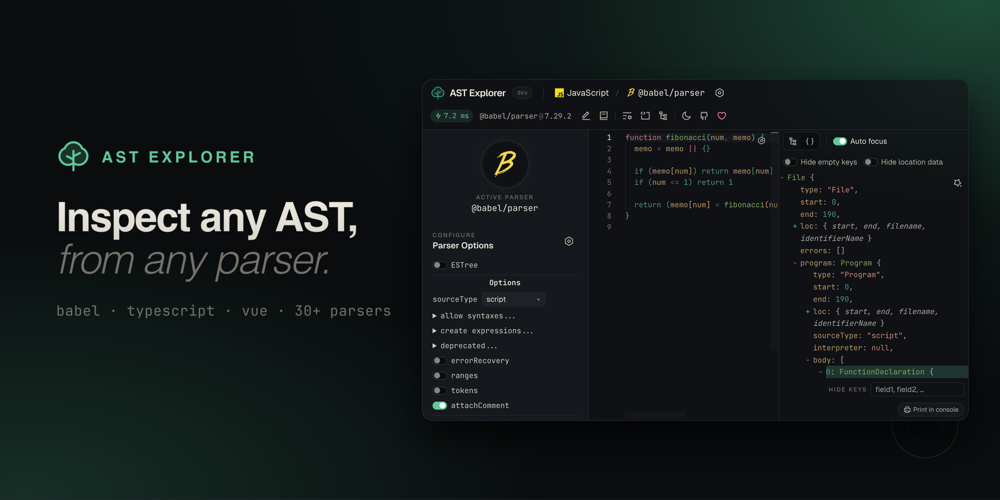

<div align="center">
  
  <h1>AST Explorer</h1>
</div>

AST Explorer - A web tool to explore the ASTs generated by parsers.

- Stable Release: [ast-explorer.dev](https://ast-explorer.dev/)
- Dev Channel: [dev.ast-explorer.dev](https://dev.ast-explorer.dev/)

Feel free to add more languages and parsers via PR!

<div align="center">
  
</div>

## Features

- 🦾 Enable code highlighting, suggestions, and formatting with Monaco Editor.
- 🤩 Support most popular front-end languages and parsers.
- 🗒️ Save your code via URL. No database, no server downtime.
- 🐙 Customize parser version via CDN, e.g., `@babel/parser` alpha.
- 🌈 Set custom parser options with a GUI.
- 🌚 Good-looking dark mode theme.
- 📱 Even compatible with mobile devices.

## Languages and Parsers

<details open>
<summary><b>JavaScript / TypeScript</b> (20)</summary>

- [@babel/parser](https://babeljs.io/docs/babel-parser)
- [Oxc](https://oxc.rs/docs/guide/usage/parser.html)
- [SWC](https://swc.rs/docs/usage/core#parse)
- [SWC Next](https://swc.rs/docs/usage/core#parse)
- [Yuku](https://yuku.fyi)
- [acorn](https://github.com/acornjs/acorn)
- [acorn-loose](https://github.com/acornjs/acorn)
- [TypeScript (legacy)](https://www.typescriptlang.org/)
- [TypeScript (WASM)](https://www.typescriptlang.org/)
- [espree](https://github.com/eslint/espree)
- [@typescript-eslint/parser](https://typescript-eslint.io/packages/parser/)
- [tree-sitter-javascript](https://github.com/tree-sitter/tree-sitter-javascript)
- [tree-sitter-typescript](https://github.com/tree-sitter/tree-sitter-typescript)
- [tree-sitter-tsx](https://github.com/tree-sitter/tree-sitter-typescript)
- [esprima-next](https://github.com/node-projects/esprima-next)
- [Flow](https://github.com/facebook/flow/tree/main/packages/flow-parser)
- [Hermes](https://github.com/facebook/hermes)
- [meriyah](https://github.com/meriyah/meriyah)
- [ohos-typescript](https://gitcode.com/openharmony/third_party_typescript)
- [go-fAST](https://github.com/t14raptor/go-fast)

</details>

<details>
<summary><b>Vue</b> (5)</summary>

- [@vue/compiler-sfc](https://github.com/vuejs/core/tree/main/packages/compiler-sfc#api)
- [@vue/compiler-sfc (script setup)](https://github.com/vuejs/core/tree/main/packages/compiler-sfc#api)
- [@vue/compiler-dom (parse)](https://github.com/vuejs/core/tree/main/packages/compiler-dom)
- [@vue/compiler-dom (compile)](https://github.com/vuejs/core/tree/main/packages/compiler-dom)
- [vue-eslint-parser](https://github.com/vuejs/vue-eslint-parser)

</details>

<details>
<summary><b>Svelte</b> (1)</summary>

- [svelte/compiler](https://svelte.dev/docs/svelte-compiler#parse)

</details>

<details>
<summary><b>Astro</b> (2)</summary>

- [@astrojs/compiler](https://github.com/withastro/compiler)
- [@astrojs/compiler-rs](https://github.com/withastro/compiler-rs)

</details>

<details>
<summary><b>Angular</b> (2)</summary>

- [@angular/compiler](https://angular.dev)
- [angular-html-parser (Angular)](https://github.com/prettier/angular-html-parser)

</details>

<details>
<summary><b>Ember</b> (2)</summary>

- [ember-estree (GJS)](https://github.com/emberjs/ember.js)
- [ember-estree (GTS)](https://github.com/emberjs/ember.js)

</details>

<details>
<summary><b>CSS</b> (4)</summary>

- [csstree](https://github.com/csstree/csstree)
- [postcss](https://postcss.org/)
- [Lightning CSS](https://lightningcss.dev/)
- [CSSOM](https://developer.mozilla.org/docs/Web/API/CSSStyleSheet)

</details>

<details>
<summary><b>HTML</b> (6)</summary>

- [htmlparser2](https://feedic.com/htmlparser2/)
- [rehype](https://github.com/rehypejs/rehype)
- [@html-eslint/parser](https://github.com/yeonjuan/html-eslint)
- [ultrahtml](https://github.com/natemoo-re/ultrahtml/)
- [angular-html-parser (HTML)](https://github.com/prettier/angular-html-parser)
- [parse5](https://github.com/inikulin/parse5)

</details>

<details>
<summary><b>JSON</b> (4)</summary>

- [json-to-ast](https://github.com/vtrushin/json-to-ast)
- [momoa](https://github.com/humanwhocodes/momoa)
- [jsonc-eslint-parser](https://github.com/ota-meshi/jsonc-eslint-parser)
- [TypeScript (legacy)](https://www.typescriptlang.org/)

</details>

<details>
<summary><b>Markdown</b> (3)</summary>

- [remark](https://github.com/remarkjs/remark)
- [Comark](https://comark.dev)
- [marked](https://github.com/markedjs/marked)

</details>

<details>
<summary><b>YAML</b> (4)</summary>

- [yaml](https://eemeli.org/yaml/)
- [yaml-eslint-parser](https://github.com/ota-meshi/yaml-eslint-parser)
- [yaml-unist-parser](https://github.com/prettier/yaml-unist-parser)
- [GitHub Workflow](https://github.com/actions/languageservices)

</details>

<details>
<summary><b>Rust</b> (3)</summary>

- [syn](https://docs.rs/syn)
- [jinx-rust](https://github.com/jinxdash/jinx-rust)
- [tree-sitter-rust](https://github.com/tree-sitter/tree-sitter-rust)

</details>

<details>
<summary><b>SQL</b> (1)</summary>

- [sql-parser-cst](https://github.com/nene/sql-parser-cst)

</details>

<details>
<summary><b>PHP</b> (1)</summary>

- [php-parser](https://github.com/glayzzle/php-parser)

</details>

<details>
<summary><b>Java</b> (1)</summary>

- [java-parser](https://github.com/jhipster/prettier-java/tree/main/packages/java-parser)

</details>

<details>
<summary><b>Python</b> (2)</summary>

- [pyodide](https://pyodide.org/)
- [tree-sitter-python](https://github.com/tree-sitter/tree-sitter-python)

</details>

<details>
<summary><b>Shell</b> (2)</summary>

- [unbash](https://github.com/webpro-nl/unbash)
- [tree-sitter-bash](https://github.com/tree-sitter/tree-sitter-bash)

</details>

<details>
<summary><b>C#</b> (1)</summary>

- [tree-sitter](https://github.com/tree-sitter/tree-sitter-c-sharp)

</details>

<details>
<summary><b>Solidity</b> (1)</summary>

- [solidity-parser](https://github.com/solidity-parser/parser)

</details>

<details>
<summary><b>WXML</b> (1)</summary>

- [@wxml/parser](https://github.com/wxmlfile/wxml-parser)

</details>

<details>
<summary><b>GraphQL</b> (1)</summary>

- [graphql](https://www.graphql-js.org/docs/)

</details>

<details>
<summary><b>Protocol Buffers</b> (1)</summary>

- [protobufjs](https://github.com/protobufjs/protobuf.js)

</details>

<details>
<summary><b>General</b> (3)</summary>

- JSON AST: paste any AST as JSON to browse it
- JavaScript Code: run your own code, e.g. import any parser from a CDN
- Tree Sitter: load any [tree-sitter parser](https://github.com/tree-sitter/tree-sitter/wiki/List-of-parsers) from a WASM URL

</details>

## URL Encode Algorithm

The input code and options are stored in the URL as a hash fragment,
which is the string following the `#` symbol
and is not transmitted to the server.

#### Implementation

```ts
const code = 'code'
const parserId = 'acorn'
const optionsString = JSON.stringify({
  ecmaVersion: 'latest',
  sourceType: 'module',
})
const serialized = utoa(
  // utoa, or compress() if want to compress the data
  JSON.stringify({
    c: code,
    p: parserId,
    o: optionsString,
  }),
)
const url = `https://ast-explorer.dev/#${serialized}`

// no compress
function utoa(data: string): string {
  return btoa(unescape(encodeURIComponent(data)))
}

// compress is optional
import { strFromU8, strToU8, unzlibSync, zlibSync } from 'fflate'
function compress(data: string) {
  const buffer = strToU8(data)
  const zipped = zlibSync(buffer, { level: 9 })
  const binary = strFromU8(zipped, true)
  return btoa(binary)
}
```

## Contributing

To contribute to the project, see [Contribution Guide](https://github.com/sxzz/contribute).

## Credits

This project references and is inspired by [fkling/astexplorer](https://github.com/fkling/astexplorer), an open-source web tool for exploring the ASTs generated by various parsers.

Also, thanks to the following projects for their contributions:

- https://play.swc.rs/

## Sponsors

<p align="center">
  <a href="https://cdn.jsdelivr.net/gh/sxzz/sponsors/sponsors.svg">
    
  </a>
</p>

<br />
<br />
<a href="https://vercel.com/open-source-program">
  
</a>

## License

[AGPL-3.0](./LICENSE) License © 2023-PRESENT [三咲智子](https://github.com/sxzz)
